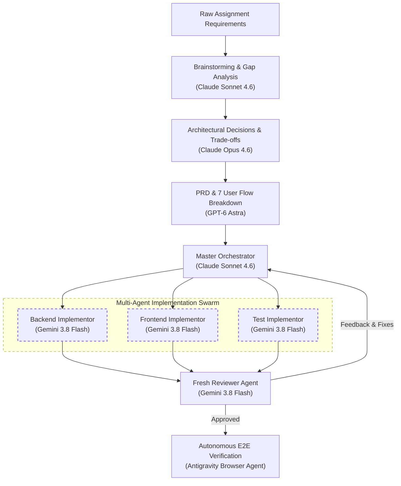

# AI Usage and Multi-Model Engineering Workflow

## 1. Tools Utilized

- **`OpenAI Codex`:** Used during early ideation, initial prompt formulation, and contract structuring.
- **`Google Antigravity`:** Used as the primary agentic execution workspace, managing multi-agent orchestration, file system operations, terminal build verification, and interactive browser automation.

---

## 2. Multi-Model Lifecycle Approach

The system was developed using a tiered multi-model workflow where each phase was assigned to a model suited for that cognitive task:

1. **Brainstorming & Gap Analysis** (`Claude Sonnet 4.6`):
   Analyzed raw requirements to identify edge cases, missing specifications, race condition risks, and RFC 7807 error schema contracts.

2. **Architectural Decisions & Trade-off Evaluation** (`Claude Opus 4.6`):
   Evaluated core system trade-offs and authored formal Architecture Decision Records (ADRs). Key decisions included row-level locking (`SELECT ... FOR UPDATE`) versus pre-allocated seats, PostgreSQL advisory locking for multi-instance safety, and Server-Sent Events versus polling.

3. **PRD & User Flow Decomposition** (`GPT-6 Astra`):
   Synthesized architecture decisions into a unified Product Requirements Document (PRD). The implementation was split into 7 discrete user flows, mapping UI states directly to backend endpoints.

4. **Implementation Orchestration** (`Claude Sonnet 4.6`):
   Served as the Master Orchestrator, coordinating file modifications, task scheduling, dependency ordering, and dispatching subagent assignments.

5. **Multi-Agent Implementation via TDD** (`Gemini 3.8 Flash`):
   Executed parallel implementation via specialized subagents following Test-Driven Development (TDD) across three streams: backend Minimal APIs and EF Core, frontend React 19 UI and SSE synchronization, and integration concurrency test suites.

6. **Code Review & Quality Assurance** (`Gemini 3.8 Flash` - Fresh Reviewer Agent):
   Ran independent code audits in an isolated context without conversational memory. Verified test coverage, schema integrity, and specification compliance to prevent confirmation bias.

7. **End-to-End Acceptance Testing** (`Google Antigravity Browser Agent`):
   Executed manual end-to-end flows in an interactive Chrome webview. Verified seat holds, live ticking countdown timers, payment confirmation, and Bengali localization.

---

## 3. Workflow Flowchart

---

## 4. 3 Sample Interventions in AI's Work

### 1. Real-Time Seat Updates (Database Notifications & SSE)
- **What happened:** The AI initially proposed updating available seat counts through frequent client-side timed polling, which wastes network bandwidth and risks displaying stale capacity under concurrent loads.
- **Resolution:** I intervened and instructed the team to implement PostgreSQL `LISTEN / NOTIFY` database triggers streaming real-time seat changes through backend Server-Sent Events directly to the UI per ADR-07.

### 2. Hold Expiry Mechanism and Multi-Instance Coordination
- **What happened:** The AI initially suggested using `pg_cron` or client-driven lazy expiry, which created brittle custom database image dependencies and stale read anomalies.
- **Resolution:** I instructed the agent to implement a native .NET background hosted worker with PostgreSQL advisory locks for multi-instance safety, backed by immediate in-transaction time filtering per ADR-01.

### 3. Single Global Active Hold and Admission Constraint
- **What happened:** The AI originally allowed students to hold seats in multiple classes simultaneously because the assignment did not explicitly restrict multi-class reservations.
- **Resolution:** I instructed the system to enforce a strict global constraint permitting only one active hold or confirmed admission per student across all classes using a PostgreSQL partial unique index.
